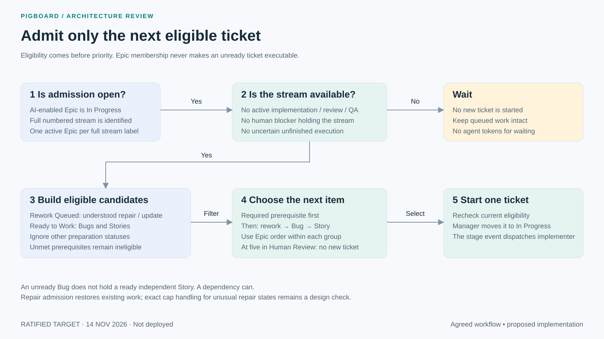

# Pigboard

**Pig Boss** is Pigboard's planned customer-hosted manager: one AWS installation for multiple Jira projects, project-scoped workstreams and basic operating health. See the [current design](docs/architecture/pig-boss-operations.md) and [MVP delivery set](docs/delivery/manager-r1/README.md). This behavior is not shipped yet.

Pigboard helps agents deliver scoped Jira work through implementation, independent
PR review and prescribed QA. Jira holds requirements and progress; Cursor runs the
prepared skills; humans review and approve what ships.

## Start here

| What you want to do | Guide |
| --- | --- |
| Use Pigboard as an agent | [Choose a skill and supply its inputs](docs/using-pigboard.md) |
| Install or update the shared skills | [Installation, verification and recovery](docs/install.md) |
| Contribute to Pigboard | [Agent entry point](AGENTS.md) and [contributor agreement](CONTRIBUTING.md) |
| Understand the product and next work | [Architecture and current Jira scope](ARCHITECTURE.md) |
| Validate or preview multi-project configuration | [Local scope checker and configuration guide](docs/configuration.md) |
| Configure the existing delivery workflow | [Workflow contract](docs/workflow.md), [Jira setup](docs/jira-setup.md) and [Cursor matrix](config/cursor/automations.md) |

The [product specification consolidation](https://github.com/danielchappell/Pigboard/pull/73)
provides the readable requirements for the proposed release. In checkouts that
contain it, start with `docs/product/README.md`, then follow its technical-contract
and coverage links. Specification review does not establish shipped behavior or
complete implementation Story coverage.

## What is available

| Capability | State |
| --- | --- |
| Fourteen shared skills: authoring, composed implementation, review, writing and QA | In the repository and installation allowlist |
| Pinned skill preparation, verified stable installation and helper dependencies | Implemented; local installer tests available |
| Jira-to-Cursor implementation, PR review and QA setup | Configured for the pilot; recorded inactive, with bounded live delivery acceptance still pending in [PGB-58](https://scubapig.atlassian.net/browse/PGB-58) |
| Local multi-project configuration validation and change preview | Implemented in source and prepared validator; no provider writes or live readiness |
| Customer-owned Lambda manager with DynamoDB admission state | Approved direction; discovery and complete Story-set review precede implementation under [PGB-66](https://scubapig.atlassian.net/browse/PGB-66) |
| Structured Story/Bug implementer with separate job/Jira skills and typed handoff | Prepared capability; structured reviewer receipt handoff is available, QA migration and full-loop acceptance remain pending |
| Manager-driven admission, repair orchestration and compatible review/QA handoffs | Later coordinated release work |

The current pilot uses Safeguard INT, numbered `AI-Daniel-<digits>` workstreams and
Plexus on `master`; its boards currently isolate `AI-Daniel-1`. These are that
installation's settings, not values to copy into a new customer's setup. Each
assigned Story or Bug names one repository allowed by its prepared environment.

## How the installed workflow moves

| Jira stage | Owner and result |
| --- | --- |
| In Progress | Implementer plans with High, obtains one independent High plan review, implements with Medium, opens or updates one PR, verifies current CI/artifacts, then publishes/read-backs a typed record before In Review. Known dependency wait goes to Rework Queued; human blockers to Blocked. |
| In Review | Independent High reviewer checks ticket and PR; verified approval moves it to QA. |
| QA | High QA agent runs the ticket's named skills and prescribed cases, retaining evidence; success moves the open PR to Human Review. |
| Human Review | Responsible developer and human QA reviewer assess the PR before human merge. |
| Product Acceptance | Human acceptance after deployment to UAT. |
| Done | Verified production deployment. |

The [structured reviewer](skills/pigboard-pr-review/SKILL.md) consumes the implementation record and queues all confirmed repairs on the same PR through [reviewer-jira](skills/reviewer-jira/SKILL.md); verified current approval permits QA. Retained QA still returns defects to In Progress and does not consume typed receipts; this mixed bundle must stay inactive. Missing access,
incomplete instructions or required scope expansion blocks the ticket for a human.
Discussion stays in Review or QA. Workers do not select new work, merge, deploy or
retry blocked work. The planned manager changes admission and repair routing only
when its coordinated release is implemented and accepted. See the
[installed workflow](docs/workflow.md) for current contracts.

## What is in this repository

- `skills/`: complete skill folders, references and prepared QA helpers.
- `config/skill-bundle.json`: the installation allowlist.
- `scripts/`: deterministic skill preparation, installation and reviewer CLI setup.
- `config/cursor/` and `config/jira/`: prompts, setup records and rule exports.
- `test/`: installation, refresh, failure and bootstrap checks.
- `docs/architecture/`: current target designs and discovery evidence.

## Fetch the skills outside the application repository

Follow [the installation guide](docs/install.md). It covers obtaining a pinned
checkout, prerequisites, bundle preparation, verified Cursor installation and
success receipts. Shared skills stay outside the target application's checkout.
The root package is private; distribution uses these Git-based scripts.

## Refresh and recovery

Follow [refresh, rollback and removal](docs/install.md#refresh-rollback-and-removal).
An agent consumes its prepared snapshot. Operators change the source pin and
verify the Build before an authorized activation. A failed Build can leave an
older snapshot selected.

## Author an Epic, Story or Bug

Use [write-pr-sized-stories](skills/write-pr-sized-stories/SKILL.md), its
[versioned ticket guide](skills/write-pr-sized-stories/references/pigboard-ticket.md)
and [examples](skills/write-pr-sized-stories/references/pigboard-example.md).
The writer emits full editable YAML with plain prose, separate AI/human cases
and explicit unresolved inputs. See [authoring and local validation](docs/authoring.md)
for the Epic route, templates, trusted facts and actual checks. Generic research
and design remain Tasks. The [implementer composer](skills/implementer-entrypoint/SKILL.md)
accepts current structured Story/Bug assignments and separates job evidence from
verified Jira publication. The reviewer uses canonical implementation receipts; only QA retains its basic prose contract;
compatible full-loop execution, manager admission and activation remain later work.

## Cursor automations

Use the versioned prompts and prepared capabilities described in
[installation](docs/install.md#cursor-environment-setup) and
[agent usage](docs/using-pigboard.md). The
[automation matrix](config/cursor/automations.md) owns the pilot's selected pins,
Build evidence, inactive states and remaining acceptance work.

## Validation and status

Contributors run `npm ci --ignore-scripts --no-audit --no-fund` then `npm test`.
Fixture checks do not prove live npm, Cursor, Jira or Bitbucket behavior.
Prepared skills, a successful Build, published code, enabled automation and a
completed real Story are separate outcomes. Jira owns current progress; setup
records retain dated evidence.

## Target architecture and first manager release

The owner ratified the target diagrams on 14 November 2026. They show the eventual
product; the [architecture map](ARCHITECTURE.md) separates installed behavior,
first-manager scope and follow-on capabilities.

[First manager scope](docs/architecture/manager-release-one.md) ·
[State and upgrades](docs/architecture/manager-state.md) ·
[Stack repair](docs/architecture/manager-stack-repair.md) ·
[Discovery progress](docs/architecture/manager-discovery.md) ·
[Ordered Jira work](docs/architecture/manager-release-one-plan.md) ·
[Architecture guide](docs/architecture/target/review-guide.md) ·
[Downloadable walkthrough](docs/architecture/target/index.html)

The first manager is planned for customer-owned AWS Lambda and DynamoDB. Existing
Jira rules continue to launch Cursor. Scuba Pig receives no customer runtime data
or credentials. Monitoring and duplicate-launch prevention are later work.

Inside the manager

Admission rules

Worker handoffs

Separate skills

Workstreams and capacity

Stack repairs

Pausing an Epic

Future worker visibility

## License

Pigboard is licensed under the [Apache License 2.0](LICENSE). See [NOTICE](NOTICE)
for retained copyright notices. Third-party dependencies retain their own licenses.
