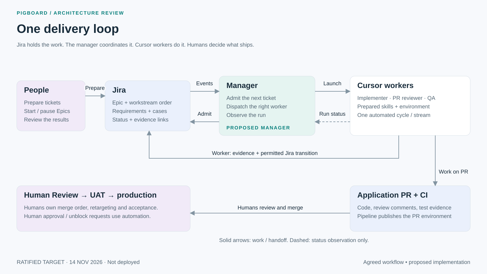
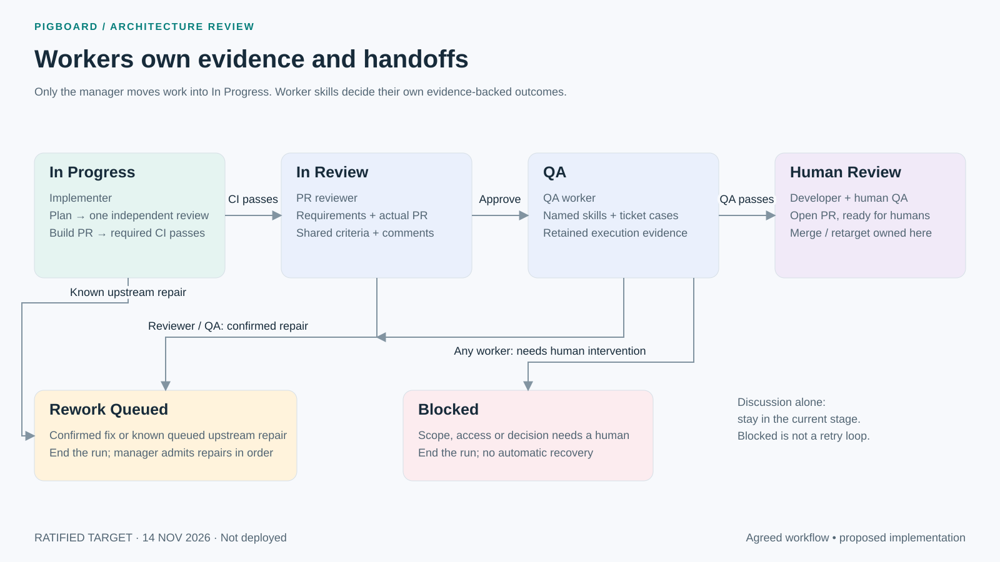
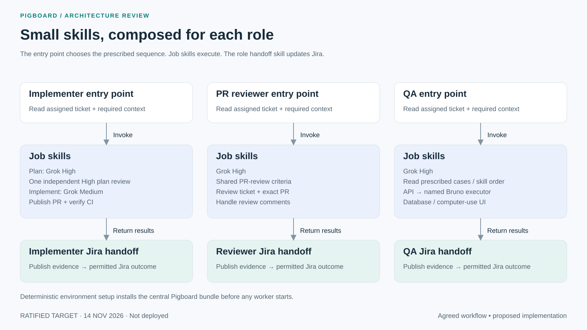
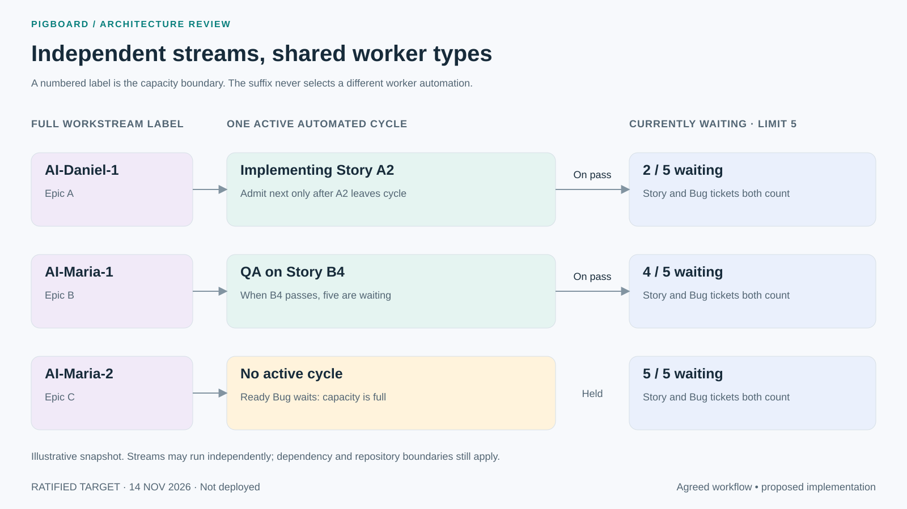
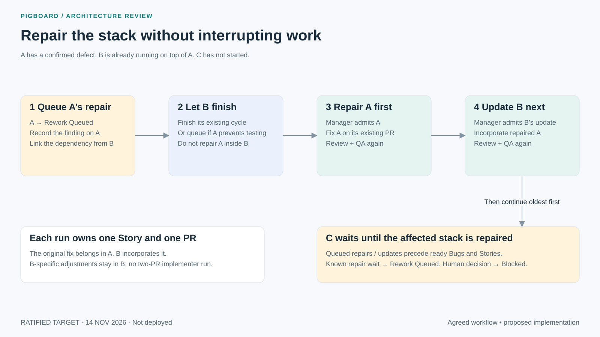
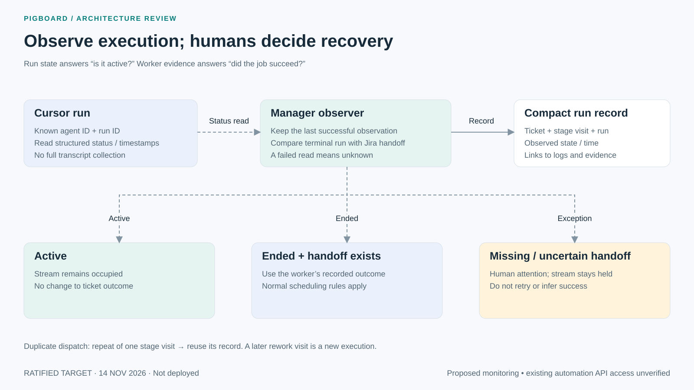

# Pigboard

**Pig Boss** is Pigboard's planned customer-hosted manager: one AWS installation for multiple Jira projects, project-scoped workstreams and basic operating health. See the [current design](docs/architecture/pig-boss-operations.md) and [MVP delivery set](docs/delivery/manager-r1/README.md). This behavior is not shipped yet.

The current source [health command](docs/manager-health.md) inspects preview and
ordinary apply processing with readable or JSON results. New lifecycle packages
include four console-only CloudWatch alarms for missing completion, Lambda errors,
throttles and measured budget use. Health shows their definitions and action state
alongside scan evidence. Source checks leave deployed acceptance and activation
to the customer's release process.

Pigboard helps agents deliver scoped Jira work through implementation, independent
PR review and prescribed QA. Jira holds requirements and progress; Cursor runs the
prepared skills; humans review and approve what ships.

## Our product promises

These seven promises guide how we build Pigboard and other Scuba Pig products.
They describe the standard we work toward. See [What is available](#what-is-available)
for what Pigboard supports today.

1. **Write plainly.** Use clear language in tickets, skills, reports, documentation
   and instructions. Preserve exact requirements and explain uncertainty.
2. **Configure once.** Use one authoritative customer configuration to drive
   downstream setup, without asking people to copy settings between systems.
3. **Make the whole experience exceptional.** Aim for Apple-level ease in
   installation, everyday use, updates, troubleshooting and removal. Make the
   product intuitive and discoverable, handle complexity, and guide unavoidable
   manual steps.
4. **Respect time, attention and money.** Avoid wasted tokens, repeated setup and
   endless attempts to prove a result. Preserve completed work and useful evidence.
5. **Protect customers and their control.** Secure credentials, permissions and
   actions. Keep runtime data and secrets under customer control, with no Scuba Pig
   access by default.
6. **Make human review useful.** AI should check every applicable criterion and
   provide a clear summary, a map from changed behavior to files, and evidence.
   Humans choose informed spot-checks and retain acceptance and merge authority.
7. **Build focused skills and measure their value.** Learn from community
   approaches and give each skill a coherent purpose. Compare concrete measured
   results against agents without those skills and relevant alternatives.

In a prepared release, give the implementer your assigned Jira key. It reads the
current assignment and gathers permitted facts before each action. Review its
durable result for code readiness, observed Jira status and any human action.
See [the operator journey](docs/using-pigboard.md#execute-an-assigned-delivery-stage)
and [the verification recipe](docs/using-pigboard.md#verify-implementer-preparation).

## Start here

| What you want to do | Guide |
| --- | --- |
| Use Pigboard as an agent | [Choose a skill and supply its inputs](docs/using-pigboard.md) |
| Install or update the shared skills | [Installation, verification and recovery](docs/install.md) |
| Contribute to Pigboard | [Agent entry point](AGENTS.md) and [contributor agreement](CONTRIBUTING.md) |
| Understand the product and next work | [Architecture and current Jira scope](ARCHITECTURE.md) |
| Preview ready work and repairs from complete local facts | [Offline manager preview, examples and recovery](docs/manager-preview.md) |
| Inspect requested Jira issues from a reviewed source or prepared installed validator | [Named-issue library and finite HTTPS packet](docs/manager-preview.md#inspect-named-jira-issues) |
| Use the conditional State API or bound init/inspect CLI | [State API, prerequisites and recovery](docs/manager-state.md) |
| Package the disabled customer-owned runtime | [AWS package, installation, preview and stop](docs/manager-installation.md) |
| Validate or preview multi-project configuration | [Local scope checker and configuration guide](docs/configuration.md) |
| Configure the existing delivery workflow | [Workflow contract](docs/workflow.md), [Jira setup](docs/jira-setup.md) and [Cursor matrix](config/cursor/automations.md) |

The [product specification consolidation](https://github.com/danielchappell/Pigboard/pull/73)
provides the readable requirements for the proposed release. In checkouts that
contain it, start with `docs/product/README.md`, then follow its technical-contract
and coverage links. Specification review does not establish shipped behavior or
complete implementation Story coverage.

## What is available

The source State API and DynamoDB adapter are callable by prepared Node callers.
Source also provides the disabled customer-owned AWS runtime package, generated
binding and operator init/inspect/configure/stop commands. See the
[installation guide](docs/manager-installation.md) and [State guide](docs/manager-state.md).
Local simulations do not establish installed acceptance, live IAM or activation;
the package includes the ordinary admission sender and scoped State transaction
permissions, with schedule and writes initially disabled. Activation is a separate
deliberate operator action.

| Capability | State |
| --- | --- |
| Twenty-two shared skills: engineering methods, authoring, composed delivery, review, human rework, writing and QA | In the repository and installation allowlist |
| Pinned skill preparation, verified stable installation and helper dependencies | Implemented; local installer tests available |
| Jira-to-Cursor implementation, PR review and QA setup | Configured for the pilot; recorded inactive, with bounded live delivery acceptance still pending in [PGB-58](https://scubapig.atlassian.net/browse/PGB-58) |
| Offline manager policy preview of supplied complete snapshots | Complete source and prepared-installed fixture preview of ordinary work, repair prerequisites and recorded-parent stack updates, with every readable cause identity in order. Installation verifies repair semantics with an eighth check before replacing the stable link. Local fixture evidence does not establish live discovery, delivery or activation; preview has no writes or execution authority. |
| Requested Jira issue/pointer/comment inspection | Bounded library in source and the complete prepared installed validator, with a caller-supplied secret resolver. The local dummy-HTTPS packet has an importable API and test-only fixture CLI; neither is a live Jira command. No domain discovery, receipt proof or admission. [Limits and recovery](docs/manager-preview.md#inspect-named-jira-issues) |
| Exact native Jira handoffs and original attempt facts | Source and prepared validator library for recorded proof, publication observations and native status history. Uses the configured read budget. [Read and verify](docs/manager-preview.md#read-an-exact-jira-handoff-or-original-attempt) |
| Local multi-project configuration validation and change preview | Implemented in source and prepared validator; no provider writes or live readiness |
| Customer-owned Lambda preview and ordinary admission with retained DynamoDB State | Source package/template includes sender capability and scoped State transaction permissions; schedule and writes start disabled. Human/installed acceptance, live permission verification and deliberate activation remain separate. [Guide](docs/manager-installation.md) |
| Structured prescribed API/Bruno, PostgreSQL and UI helpers | Bounded helper capability; composed by qa-entrypoint with ordered actual observations and a complete partial ledger |
| Structured Story/Bug implementer with separate job/Jira skills and typed handoff | Prepared capability; structured reviewer and QA receipt handoffs are available; full-loop acceptance remains pending |
| Structured Story/Bug QA composer and standalone qa-jira publisher | Source instruction capability; actual Grok High/helper/clock acceptance and compatible installed/live release remain separate |
| Human-invoked request-rework | Prepared separate skill; requires an existing compatible current QA chain, configured actor and explicit human authorization; no activation |
| Same-open-PR repair execution and repeated authorized human rejection | Source/same-release prepared capability for compatible supplied admissions. Worker preflight checks current PR openness and freshness. |
| Recorded same-PR ordinary repair preview | Optional canonical `manager.rework_enabled: true`; authenticated own-ticket requests and complete unresolved causes, zero writes. [Prerequisites, commands and holds](docs/manager-preview.md#recorded-same-pr-repair-preview) |
| Manager admission of one supported same-PR repair | Compatible source sender uses the canonical rework opt-in, existing write authority and configured direct Rework Queued → In Progress edge. [Sender prerequisites and recovery](docs/manager-apply.md) |

The current pilot uses Safeguard INT, numbered `AI-Daniel-<digits>` workstreams and
Plexus on `master`; its boards currently isolate `AI-Daniel-1`. These are that
installation's settings, not values to copy into a new customer's setup. Each
assigned Story or Bug names one repository allowed by its prepared environment.

## How the installed workflow moves

| Jira stage | Owner and result |
| --- | --- |
| In Progress | Implementer plans with High, obtains one independent High plan review, implements with Medium, opens or updates one PR, verifies current CI/artifacts, then publishes/read-backs a typed record before In Review. Prepare declared artifacts as their inputs become available. The same Jira publisher can deliver a verified missing-input blocker or dependency wait. Other inability stays local. |
| In Review | Independent High reviewer checks ticket and PR; verified approval moves it to QA; complete confirmed defects queue on the same open PR. |
| QA | High QA agent runs the ticket's named skills and prescribed cases, retaining evidence; success moves the open PR to Human Review; complete confirmed defects queue with the full partial ledger. |
| Human Review | Responsible developer and human QA reviewer assess the PR before human merge; explicit authorized findings may queue the same open PR through request-rework. |
| Product Acceptance | Human acceptance after deployment to UAT. |
| Done | Verified production deployment. |

The [structured reviewer](skills/pigboard-pr-review/SKILL.md) consumes the actual
implementation record; only verified current approval permits QA through
[reviewer-jira](skills/reviewer-jira/SKILL.md). The [QA composer](skills/qa-entrypoint/SKILL.md)
retains all prescribed helper results and delegates one final assessment to
[qa-jira](skills/qa-jira/SKILL.md). Complete confirmed reviewer/QA defects can publish
one repair_request and verify the direct Rework Queued transition. The
[same-release support matrix](docs/handoffs.md#ordinary-worker-release-boundary)
states exact proof and destinations. Independent inability, incomplete work, causal
waits and unsupported repair/resume retain all findings and partial ledgers locally.
Queueing grants no admission/pointer/State authority; live acceptance and later
automatic repair admission remain separate. Supported supplied same-PR repair admissions can execute through fresh implementation, independent review and prescribed QA; repeated current human rejection is available on the new QA basis.

Discussion stays in its current stage. The separately prepared request-rework skill
uses explicit human-current proof; unsupported legacy shapes have no fallback. Saved wiring, provider
acceptance and owner activation remain separate gates. Workers do not select new
work, merge, deploy or retry blocked work. See the [installed workflow](docs/workflow.md)
for current contracts.

## What is in this repository

- `skills/`: complete skill folders, references and prepared QA helpers.
- `config/skill-bundle.json`: the installation allowlist.
- `scripts/`: deterministic skill preparation, installation and reviewer CLI setup.
- `config/cursor/` and `config/jira/`: prompts, setup records and rule exports.
- `test/`: installation, refresh, failure and bootstrap checks.
- `docs/architecture/`: current target designs and discovery evidence.

## Fetch the skills outside the application repository

Follow [the installation guide](docs/install.md). It covers obtaining a pinned
checkout, prerequisites, bundle preparation, verified Cursor installation and
success receipts. Shared skills stay outside the target application's checkout.
The root package is private; distribution uses these Git-based scripts.

## Refresh and recovery

Follow [refresh, rollback and removal](docs/install.md#refresh-rollback-and-removal).
An agent consumes its prepared snapshot. Operators change the source pin and
verify the Build before an authorized activation. A failed Build can leave an
older snapshot selected.

## Author an Epic, Story or Bug

Use [write-pr-sized-stories](skills/write-pr-sized-stories/SKILL.md), its
[versioned ticket guide](skills/write-pr-sized-stories/references/pigboard-ticket.md)
and [examples](skills/write-pr-sized-stories/references/pigboard-example.md).
The writer emits full editable YAML with plain prose, separate AI/human cases
and explicit unresolved inputs. See [authoring and local validation](docs/authoring.md)
for the Epic route, templates, trusted facts and actual checks. Generic research
and design remain Tasks. The [implementer composer](skills/implementer-entrypoint/SKILL.md)
accepts current structured Story/Bug assignments and separates job evidence from
verified Jira publication. The reviewer and QA composer consume canonical current receipts.
Compatible saved wiring, full-loop acceptance, manager admission and activation
remain separate work; old prose tickets are not automatically converted.

## Cursor automations

Use the versioned prompts and prepared capabilities described in
[installation](docs/install.md#cursor-environment-setup) and
[agent usage](docs/using-pigboard.md). The
[automation matrix](config/cursor/automations.md) owns the pilot's selected pins,
Build evidence, inactive states and remaining acceptance work.

## Validation and status

Contributors run `npm ci --ignore-scripts --no-audit --no-fund` then `npm test`.
Fixture checks do not prove live npm, Cursor, Jira or Bitbucket behavior.
Prepared skills, a successful Build, published code, enabled automation and a
completed real Story are separate outcomes. Jira owns current progress; setup
records retain dated evidence.

## Target architecture and first manager release

The owner ratified the target diagrams on 14 November 2026. They show the eventual
product; the [architecture map](ARCHITECTURE.md) separates installed behavior,
first-manager scope and follow-on capabilities.

[First manager scope](docs/architecture/manager-release-one.md) ·
[State and upgrades](docs/architecture/manager-state.md) ·
[Stack repair](docs/architecture/manager-stack-repair.md) ·
[Discovery progress](docs/architecture/manager-discovery.md) ·
[Ordered Jira work](docs/architecture/manager-release-one-plan.md) ·
[Architecture guide](docs/architecture/target/review-guide.md) ·
[Downloadable walkthrough](docs/architecture/target/index.html)

The first manager is planned for customer-owned AWS Lambda and DynamoDB. Existing
Jira rules continue to launch Cursor. Scuba Pig receives no customer runtime data
or credentials. Monitoring and duplicate-launch prevention are later work.

Inside the manager

Admission rules

Worker handoffs

Separate skills

Workstreams and capacity

Stack repairs

Pausing an Epic

Future worker visibility

## License

Pigboard is licensed under the [Apache License 2.0](LICENSE). See [NOTICE](NOTICE)
for retained copyright notices. Third-party dependencies retain their own licenses.

The [engineering skills guide](docs/engineering-skills.md) explains the focused planner,
codebase investigation, design, diagnosis and author-verification methods. Their
comparative effectiveness has not yet been measured.

The [structured helper guide](docs/using-pigboard.md#prescribed-structured-qa-helpers)
explains exact inputs, preparation and recovery. API owns one Bruno child;
PostgreSQL uses parameterized two-hop bindings; UI retains prescribed screenshots.
Missing prerequisites return inability, demonstrated mismatches return defects.
Helpers do not move Jira or run human cases. The [QA composer](skills/qa-entrypoint/SKILL.md)
now supplies their structured inputs, inspects actual outputs and retains every
partial row. Its source presence does not prove actual model/helper/clock behavior
or activate delivery.

## Publish an already prepared QA assessment

The standalone [qa-jira skill](skills/qa-jira/SKILL.md) checks current native QA
Story/Bug authority, validates the complete supplied ledger and publishes one
verified handoff. Prepare current assignment/review/open-PR/CI evidence, accessible
artifacts, same-release validators and configured Jira actor/append/read/direct
transition access first. [Direct use and recovery](docs/using-pigboard.md#publish-prepared-qa-evidence)
cover preflight and final modes. It runs no QA helpers. The compatible qa-entrypoint
composes ordered execution with one final publisher call. Install all siblings from
one reviewed release; actual Grok High, bounded clock and qualified helper execution
need their own evidence. Installed/live release acceptance and automation activation
remain separate gates.

Inspect an ordinary supplied comment from source or a complete prepared copy with the pure [handoff candidate API](docs/manager-preview.md#inspect-a-supplied-handoff-comment). It distinguishes ordinary content, one canonical candidate and malformed attempts without provider calls, writes or receipt authority.

### Collect ordinary Jira facts

Import `lib/jira/inventory.mjs` from source or the prepared receipt's
`skills/work-validator` root. It collects bounded native Jira
membership, occupancy, original descriptions/comments and required exact typed
references. Supply confirmed retained inventory and the prepared canonical read
configuration/resolver. Safe reports distinguish complete, isolated holds and
shared holds; private observations remain in memory. Confirmed pointer absence
requires a successful property-key enumeration; a 404 remains unknown.
See the [inventory guide](docs/manager-preview.md#complete-ordinary-jira-inventory-library)
for prerequisites, use, fixture commands and recovery. Core PGB-162 owns semantic
normalization and selection. The [AWS runtime package](docs/manager-installation.md)
composes these APIs and has separate installed journey acceptance.
This library neither authenticates receipts nor performs admission or activation.

The [ordinary recorded preview](docs/manager-preview.md#ordinary-recorded-policy)
uses explicit `--mode ordinary` and snapshot/v2 in source and the prepared validator.
It selects ordinary work from complete supplied facts. Set `manager.rework_enabled`
to true to preview supported same-PR repairs. For held work, see the stream's
reason. The preview cannot detect hidden external PR changes. Existing v1 fixture
repair preview remains available without the mode flag. Both routes produce
zero writes and grant no execution or activation authority. The source AWS wrapper uses native Jira
inventory, confirmed State and ordinary preview policy. Designated human and
installed acceptance remain separate.

## Ordinary worker compatibility

Use `worker-current` for new work, an eligible repair on the same open PR,
and ordinary implementation, review and QA handoffs. For a repair, the checker
validates the supplied current action proof, authenticated assignment history
and complete set of recorded repair requests. The worker checks PR openness
and freshness when it acts.

Use `worker-assignment` when an implementer verifies that a prepared input
is missing or a dependency requires a wait. Each publication needs its own
authorized direct edge. Reviewer and QA inability, null-PR and stack-request
repair execution, and resume remain deferred. Keep local findings and original
receipts when an action holds. Provider acceptance and live authority require
separate evidence.

See the [ordinary worker contract](docs/handoffs.md#ordinary-worker-release-boundary)
for exact eligibility, readback and recovery.

The [ordinary sender guide](docs/manager-apply.md) describes the bounded admission
implementation and its prepared host prerequisites. Sender packages remain
initially disabled. With rework opted in on a compatible revision, the sender
can admit one authenticated same-PR repair and retain the actual previous
assignment and every unresolved request. If admission holds after an attempt
began, inspect that original attempt. Local developer checks are separate from
installed delivery acceptance and deliberate activation.
