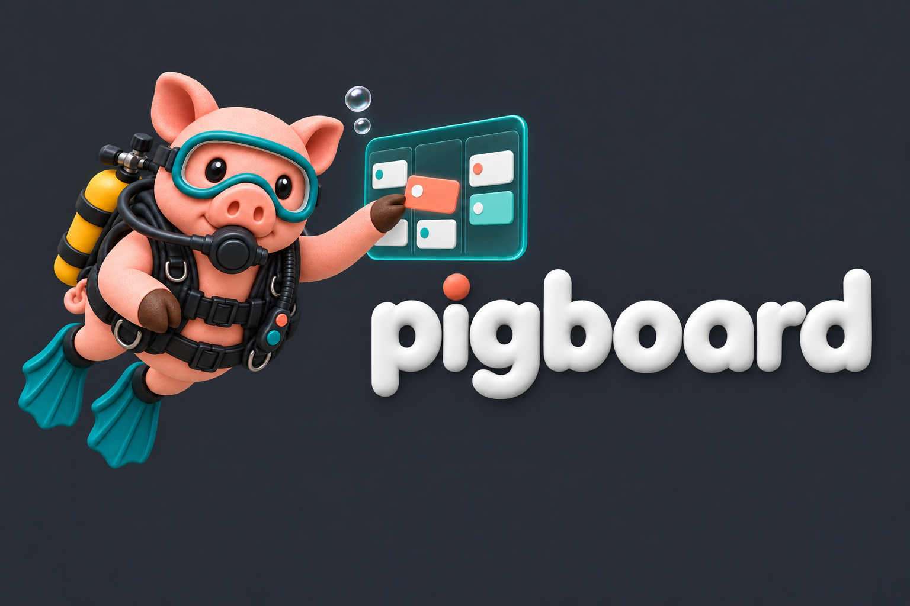

# Pigboard logo candidates

4 October 2026. Generated candidates for the owner's rebrand request, using the
established Scubapig mascot and Rovito visual family. These are ready for visual
feedback; they are not yet owner-approved final artwork.

## The series

| Asset | Use | Source |
| --- | --- | --- |
| [Pig and board](mascot-board-v1.png) | Flexible hero/illustration on a dark background | 1536 × 1024 PNG, RGBA with transparent pixels |
| [Graphite wordmark](lockup-graphite-v1.png) | Wide brand composition and marketing reference | 1536 × 1024 PNG, graphite background |
| [Compact avatar](avatar-graphite-v1.png) | Profile/brand avatar at medium sizes | 1254 × 1254 PNG, graphite background |

## Identity and use

Keep the same pink pig, triangular ears, teal mask, black BCD, yellow tank,
regulator and split front hooves across applications. The floating panel is an
illustrative Kanban board. It does not depict an available Pigboard dashboard.
Prose uses **Pigboard**; the wordmark uses **pigboard** with Rovito's rounded white
letters and a coral dot above the i.

Use the graphite composition on Rovito's `#272c33` family of backgrounds.
The transparent mascot includes soft colored edge glow and should be checked
against its final background. Its alpha ranges from 0 to 254; it is not a
pixel-perfect opaque cutout. The graphite images are generated raster scenes,
so their backgrounds should not be assumed to be a perfectly uniform CSS color.
Do not tile them or use a small crop as a flat page background.

The compact avatar preserves more detail than a favicon can show. Use it at
128 px or larger until a small-icon derivative is checked. Keep text and core
navigation as accessible HTML; do not rely on the image wordmark as the only
accessible product name. Suggested mascot alt text: “Scuba pig moving a card
on a floating Kanban board.” Use empty alt text when adjacent copy already
provides the same information and the artwork is decorative.

## References and generation prompts

Generated with the built-in imagegen tool on 4 October 2026. Source PNGs are
copied without alteration. The character reference was the foreground pig in
the owner's 19 June Scubapig group artwork, original file
`ig_0b3ae0e071c4dab0016a37e6460784819193952e1855c73fa3.png`.
The style reference was Rovito's `website/assets/rovito-lockup-graphite.png`
at commit `32875af00a19241541296bbb10543ec29fcb7a42`.

Prompt specifications used:

- **Mascot:** preserve only the foreground pig's identity, match Rovito's soft
  rounded 3D clay/plastic style and professional equipment, float in three-quarter
  view beside a translucent three-column Kanban board with white/teal/coral cards;
  one cloven hoof moves a card; no words; request true transparency and padding.
- **Wordmark:** use the generated mascot as the character reference and Rovito
  as the composition reference; pig left, smaller floating board above the
  middle, exact lowercase `pigboard` in rounded white 3D letters on the right,
  coral i-dot; graphite background; clear space below the wordmark.
- **Avatar:** use the same mascot reference; upper-chest crop, same pig face,
  mask/regulator/BCD/tank, one cloven hoof and a small three-column board with
  three cards; graphite background; no text; square format.

Original generated IDs, in order: `exec-7cf8bf26-b7b3-4ed7-953f-1384c0f006d4`,
`exec-643b3337-b783-4608-9e4d-82d4dcdbaedd`, and
`exec-05116adf-79cd-4bbc-820d-9ec6d0d7b3e1`.

## Author inspection

Inspected all three full-size outputs: the same pig identity, teal/black/yellow
gear, coherent equipment, visible split hooves and recognizable board are
present; the wordmark spells `pigboard`. The head/board hierarchy remains clear
at avatar size, but task-card details are intentionally decorative. No image
claims the hosted product is available. Alpha/dimensions were inspected from
the saved files; the export limitations above remain for final production work.

Principles: **Intuitive**—familiar pig/board subject; **Discoverable**—clear file
purposes and alt-text guidance; **Delightful experience**—consistent character
family; **Token saver**—one asset guide with provenance; **Secure**—no credentials
or external account changes; **Agents are equal**—stable file names and explicit
usage/status; **Dependable**—candidates, original bytes and limitations are named.
