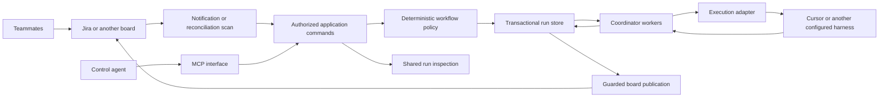

# Ski Stack architecture and development direction

Updated 26 September 2026 for the Pigboard pilot. High-level design for
independent review. This defines the
path to the agreed product; it is not implementation, infrastructure procurement
or activation approval. The [development workflow](development-workflow.md)
requires this design gate before grooming the delivery plan.

## Pigboard direction and foundation boundary

The owner has chosen an opinionated AI SDLC, using the existing Ski Stack method
as the starting process. Settle the architecture and dependency-ordered roadmap,
then deliver the core in small usable slices. Improve the method after we can
operate and observe it on that foundation. Commercial discovery is not a blocker
to this authorized foundation work; existing access and verification gates remain.

The component and authority boundaries below are retained. Core policy routes
work, shared state records ownership/evidence, adapters connect Jira and supported
runners, and application commands expose the same facts to people and agents.
Profiles map project context onto a supported method; they are not a commitment
to a general workflow designer. Preserve the existing local workflow while adding
the hosted path. Do not redesign the method to justify new infrastructure.

M1/M2 prove setup and one hosted handoff. M3 carries the existing development
lifecycle onto that path, including its review and owner-decision boundaries.
Packages and MCP keep their actual M4/M5 dependencies; broader scale remains M6.
Method improvements can then follow observed outcomes without waiting for every
future provider or multi-team feature. This ordering does not claim M2 alone
proves the complete AI SDLC or that owner experience is hosted acceptance evidence.

## Product outcome

A team coordinates software work through its Kanban board. Moving an opted-in
card to an eligible stage dispatches the configured role through deterministic
code. Product, research, architecture and development roles have different
perspectives and can challenge one another through recorded review handoffs.
Agents publish work and evidence back to the ticket. Humans retain the decisions
and permissions assigned to them. A control agent can use MCP to inspect the
same team and create work through the same authorized application commands.

Ski Stack is a hosted service. Coordination and cloud execution continue with
developers' laptops off, and authorized teammates can see progress. Roles,
skills, workflow mappings and runner configuration are reusable packages rather
than individual UI setup. Cursor and Codex are intended integrations, with
capabilities checked separately for each execution environment.

The board is a complete entry point; a manager/executive agent is optional.
Summarizing and surfacing decisions are useful agent tasks. Routing, ownership,
allowed transitions, retries and quotas belong to code, not AI tie-breaking.

## First milestone and success

Prove one complete hosted journey before expanding to a general SaaS:

- One team, Jira Pigboard `PIG`, one configured repository, one researcher role and one
  active cloud job, with Cursor as the first candidate provider.
- An authorized teammate labels a Task `ai-enabled` while it is in To Do.
- Ski Stack reports queued, then provider-accepted progress; publishes findings
  and evidence; and offers the result at Product Acceptance for human review.
- Repeated notifications or coordinator restarts recover the same attempt. A
  failed board publication retries publication without rerunning the agent.
- A second authorized teammate can inspect the progress and result, and the
  coordinator does not depend on either developer's computer being awake.

Keep the human assignee. The active Pigboard board uses its existing To Do status
and an explicit opt-in label. Its filter, allowed assignees and native status ID
must be verified under the integration identity before activation. The earlier
INT board mapping and its restricted assignee filter are historical evidence,
not a Pigboard permission or workflow claim.

The company Cursor account is authorized only for trivial adapter checks. The
marker-only API probe is already complete. A repository probe, if access is
established, may read only package.json and return its name/version. Substantial
discovery/implementation stays outside that account. Full useful-discovery
acceptance requires an appropriately authorized execution environment; this plan
does not expand spending or repository grants.

## What exists and what does not

Historical baseline: main `5e48c3def05fa8dc840d51ae6683113b9faa0ba2`.
The original working checkout at `5e90721` was also inspected. Both describe
the GitHub Projects/local Codex MVP. [PR #7](https://github.com/danielchappell/ski-stack/pull/7)
later delivered the reviewed standalone Cursor command and merged externally.
That command has no repository-backed live acceptance and does not set the
hosted delivery order.

| Area | Existing evidence | Gap to this product |
| --- | --- | --- |
| Policy | `src/core/availability.js`, `routing.js` and `claim-next-available.js` choose roles/work deterministically. | A versioned workflow mapping must include opt-in, team/project scope and all eligibility-changing inputs. |
| Board integration | GitHub Projects snapshot, comments, transitions, signed handoffs and best-effort leases. | Jira connection, normalization and publication; shared transactional run authority. |
| Execution | Local Codex coding loop; four coding stages auto-run. | Async cloud lifecycle, durable recovery and provider-neutral execution contract. |
| Cursor evidence | Recorded API create, timeout recovery, conflict rejection and final result; pending start/get CLI. | Repository permissions, teammate visibility and integration with durable coordinator state. |
| Roles/assets | Planner, Researcher, Architect, Groomer and delivery role cards plus skills. | Installable versioned provider packages, compatibility and upgrade rules. |
| Visibility | Board comments, provider links and local JSONL logs. | Shared run history, setup diagnostics and access-controlled team inspection. |
| Control plane | Manual board/CLI entry and existing worker results. | Hosted service commands and MCP over the same permission and policy checks. |

Existing code is reusable, but deploying the local daemon is not this milestone.
It assumes local Codex authentication, worktrees and GitHub PR behavior. The
injected runWorker interface in the generic dispatcher is useful precedent; its
single awaited call is not a durable cloud coordinator.

## Architecture and ownership

1. **Workflow policy:** Keep eligibility, dependencies, ordering and allowed
   outcomes in the core. A workflow profile translates configured board statuses
   to supported internal stages and roles. Board adapters supply normalized facts; models
   never pick arbitrary transitions or repositories. Fingerprints must include
   every input that can make a claim stale, including opt-in and profile version.
2. **Board connection:** Translate board identity, tickets, dependencies, comments
   and transitions. Reload the board before dispatch and consequential updates.
   Webhooks are wake signals; scheduled reconciliation covers lost events and
   labels added after a status move. Avoid per-role Jira automation rules.
3. **Run authority:** A transactional store owns attempts, leases, provider IDs,
   immutable input hashes, accepted results and publication progress. Jira is
   the human work record and visible projection, not the distributed lock.
4. **Coordinator:** Short resumable steps claim, prepare, launch/recover, observe,
   validate and publish. Persist each step's intent/outcome. A sleeping HTTP
   request or a long-lived in-memory promise must not be the recovery mechanism.
5. **Execution adapter:** Prepare/start/recover/get with explicit supported
   capabilities, stable request identity and structured status. The pending
   Cursor adapter is a candidate implementation, not the universal contract.
   Cancellation and follow-ups are absent until independently designed/supported.
6. **Application commands:** Shared authorization, audit and policy for board
   events, operational CLI/API and MCP. Control agents have explicit capabilities;
   they cannot bypass claims or manufacture review authority through ticket text.
7. **Packages:** Versioned roles, skills, workflow/profile defaults and declared
   runner capabilities. Package configuration references secrets; it never embeds
   them. Instructions do not enforce isolation, permissions or spending controls.

Keep the current GitHub adapter/runtime behavior working. Its exported queue
contract combines board writes and lease ownership. Evolve additively through a
hosted coordinator boundary composed with board connections and the run store;
do not pretend Jira implements atomic ownership through comment/property writes.
The precise interface and migration are a discovery output before code Stories.
Do not rewrite the existing daemon or remove its signed handoffs incidentally.

## Durable execution and recovery contract

The intended attempt records team/project/ticket identity, stage/profile/package
versions, immutable input and repository revision, attempt number, lease owner
and generation, provider agent/run IDs, result, and publication checkpoints.
The database technology and detailed schema are not selected by this document.

| Event | Required behavior |
| --- | --- |
| Eligible work is found twice | Transactionally create/claim one current attempt for the same work/stage/input; re-evaluate current board facts. |
| Worker crashes or loses its lease | A new owner resumes the recorded attempt; old generations cannot commit coordinator state or publish accepted results. |
| Launch response is lost | Recover the original provider identity; uncertainty is explicit and does not create another attempt. |
| Provider finishes | Validate the stage's output contract; finished provider work is not accepted product work or a merged Story. |
| Human changes status, opt-in or work content | Invalidate the stale claim/result application, retain evidence and require current eligibility before a deliberate new attempt. |
| Jira write fails or its response is lost | Retain completed model work and publication intent; reconcile that operation before retrying a mutation. |
| A deliberate retry is requested | Authorize and record a new attempt linked to the old one; an event replay or comment does not authorize it. |

Use transactional ownership with a monotonically changing lease generation to
reject stale writers. Bound concurrent launches and polling. A database lock alone
does not fence an external provider or Jira request already in flight: serialize
publication/launch ownership and reconcile ambiguous external effects. Do not
promise exactly-once delivery where the provider lacks a matching guarantee.

Board publication records a stable operation marker and any returned comment ID.
On an ambiguous create, find/verify the integration's matching operation before
posting again; if it cannot be determined safely, show needs-attention rather
than blindly duplicate. Recheck ticket state before transitions and use any
supported conditional behavior verified in discovery. A race with a human's edit
must have an explicit tested policy; a fresh read alone is not atomic protection.
The transition/lease mechanism is a blocking design Task before write Stories.

## Trust, hosting and visibility

The first hosted deployment is one team, one connection and one worker. It still
has explicit team/project/repository boundaries. Every persisted key and command
carries that scope; never infer tenancy or authority from ticket text. Before a
second team, test cross-team denial for reads, writes, credentials and provider
results, and complete membership/connection ownership design.

Jira and runner credentials remain with the coordinator and its secret store,
outside prompts and agent workspaces. The board event receiver authenticates
notifications, but still reloads state using its connection. A project filter is
not authentication. Authenticate the shared inspection interface from its first
hosted release. Restrict published output to viewers authorized for its sources;
private code/context must not leak through a broader Jira audience.

Choose hosting, transactional storage, service identity, access model, retention,
backup/recovery and bounded usage controls in a focused deployment/security Task.
Use one small service and managed durable storage where practical; no Kubernetes,
message-bus fleet or billing platform is implied. Traces/progress summaries,
provider links and stored result evidence provide initial observability. A custom
chat application is not a prerequisite; the later team interface must fill actual
visibility gaps rather than duplicate Jira and provider chats.

## Architectural milestones, before grooming

This is the complete direction, not a claim that each row is a two-day Story.
Groom it into small outcomes only after independent design review.

| Milestone | Complete observable outcome | Depends on |
| --- | --- | --- |
| M0: Resolve integration and state contracts | A reviewed decision set makes the first hosted path safe and estimable. | This design; existing API evidence. |
| M1: Configure and inspect intended work | An authorized teammate saves board, repository, role and runner references, validates the setup, and sees whether a ticket is eligible and where it will go without launching work. | M0 board/config/identity decisions. |
| M2: Run one hosted discovery journey | Jira opt-in produces one durable cloud attempt, recoverable result and human-review handoff with shared visibility. | M1; durable coordinator, runner and publication decisions. |
| M3: Carry the existing software lifecycle onto the foundation | Existing product, technical discovery, architecture, grooming, planning and delivery roles exchange reviewed handoffs on the board. | M2; D5 maps the baseline process, versioned workflow and review authority. |
| M4: Reuse teams and execution providers | A teammate installs/configures versioned Cursor or Codex assets and selects a supported harness without rebuilding coordination. | M2; package/provider capability decisions; individual M3 roles may reuse packages. |
| M5: Converse with the control plane | An authorized control agent inspects work and creates an ideation ticket through MCP; scoped retry/interruption follows supported contracts. | M2 application commands; separate MCP authorization design; richer actions follow M3/M4. |
| M6: Operate as a shared SaaS | Multiple teams and concurrent workers have isolated access, bounded usage and dependable recovery/operations. | M2 and explicit tenancy, scale and operations design. |

M3-M6 are product outcomes, not a forced serial chain. Their individual slices
can run independently once actual dependencies are ready. Initial authenticated
team visibility is part of M2; M6 does not defer basic security until later.
No milestone is silently dropped because the first pilot has one role/provider.

## Alternatives and decisions

- Provider UI/native Jira integration: reuse execution, inspection and review
  capabilities where they meet the supported method's contracts. The competitor
  report does not establish that native assembly cannot supply the lifecycle.
  Evaluate concrete gaps during D1/D4; the owner has authorized the foundation
  without making a full comparative pilot its prerequisite.
- Per-role Jira automations: duplicate policy and complicate packaging. Use one
  bounded wake mechanism plus reconciliation; choose automation vs polling from
  documented access and cost evidence during setup, not assumptions about quotas.
- Board properties/comments as locks: keep them as visible projections; they do
  not establish transactional concurrency. Preserve the local MVP's documented
  best-effort behavior while adding the hosted boundary.
- Local-only all-in-one daemon: still a supported current use case, but cannot
  satisfy the agreed shared/laptop-independent product outcome by itself.
- Designing all SaaS internals now: unnecessary. Establish ownership/contracts
  and the development map, then deepen each milestone's design when needed.

## Discovery decisions required before ready Stories

| Task | Required output | Blocks |
| --- | --- | --- |
| D1: Jira identity and workflow | Auth/secret custody, project/status IDs, transition requirements, read/comment/write authority, event authentication and human-edit race policy. | Delivery-ready Jira diagnostics Stories and all Jira write activation; authorized read-only discovery is permitted within D1. |
| D2: Run/store and cloud lifecycle contract | State machine, immutable input identity, transactional claims/fencing, external ambiguity recovery, interface migration and result/publication schema. | Hosted attempt/worker Stories. |
| D3: Deployment and team access | Host/store choice, authenticated team access, source/result audience, retention/backup, quota and secret lifecycle. | Hosted deployment and shared visibility. |
| D4: Runner/repository acceptance | Provider-neutral contract; reuse/disposition of PR #7; repo permissions and second-viewer acceptance; approved environment for meaningful work. | Repository-backed cloud journey. |

D1 includes bounded read-only metadata/permission checks under already-authorized
access; it does not block the investigation needed to resolve itself. Obtain real
access only where missing, and do not probe write permission by making unapproved
mutations. Setup in M1 can begin with explicit versioned configuration and
validation commands; a package marketplace or custom UI is not required. M4 adds
reusable distribution and upgrade behavior, not the first way to configure M2.

These Tasks can overlap where their inputs are independent. Their outputs must
agree before grooming dependent ready Stories. Unknown facts are not filled with
invented commands, permissions, endpoints or schedules. Later milestones receive
focused discovery/design Tasks at their gates as well.

## Verification and author's principle assessment

Each implementation slice includes meaningful local regression checks and clear
human/agent QA. The hosted milestone additionally proves duplicate-event and
restart recovery, provider uncertainty, invalid results, partial publication,
human takeover and second-user visibility. Keep paid checks trivial under the
current company-account restriction. No new external write is performed by this
planning Task.

| Principle | Author's assessment |
| --- | --- |
| Intuitive | Existing To Do plus `ai-enabled` makes opt-in visible without a new column; To Do alone is deliberately insufficient. Exact transitions are D1's activation gate. |
| Discoverable | M1 explains the route; S02 must explain the label, status and dependency facts before agents run. Packages and MCP carry explicit capability discovery. |
| Delightful experience | Shared progress and recovery remove manual handoffs and duplicate runs; ordinary stages need no repeated owner permission. |
| Token saver | Code routes and reconciles; agents receive scoped context and expose detail on demand; no model is the scheduler. |
| Secure | Scoped authority, external secret custody and audience checks start with the first hosted path; unresolved mechanisms block dependent Stories. |
| Agents are equal | MCP and board entry share authorized commands; M5 gives a real agent control path, not just a read-only dashboard. |
| Dependable | Durable attempts separate provider completion, publication and acceptance; external ambiguity and stale writers remain explicit until verified. |

Independent verdicts and exact artifact hashes belong in
[the review record](development-review.md). The eventual delivery plan must cover
these outcomes and preserve all unresolved gates; this document alone does not
make an implementation Story ready.
