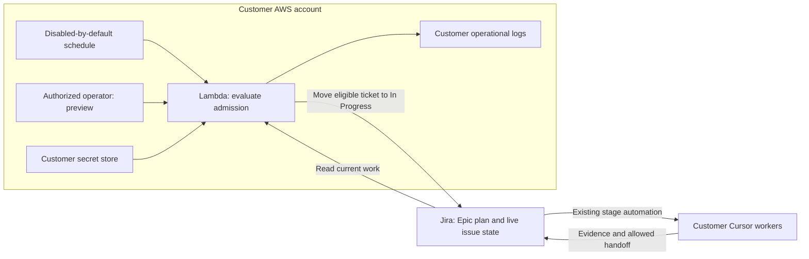

# First manager release: customer-owned AWS admission

Decision baseline: 14 November 2026. This is a scoped design, not deployed software.
The owner selected AWS Lambda and asked for Jira grooming, not implementation or
activation. The existing delivery automations remain inactive.

## Outcome and release boundary

A customer installs Pigboard in its own AWS account. It advances the next eligible
Jira ticket into In Progress without spending model tokens on scheduling. Existing
Jira rules start Cursor, and workers retain their evidence and stage handoffs.

The first release includes the deployment and operating instructions needed to use
this safely, plus the agreed admission, readiness, priority, capacity and queued
repair rules. It does not route Cursor launches through Pigboard.

Excluded: worker monitoring, duplicate-run prevention, run ledger/database, launch
proxy, cancellation, automatic recovery, transcript collection, SaaS, shared tenant
hosting, other cloud deployment packages, a dashboard, automatic PR retargeting,
automatic bug creation, Teams alerts and preview-environment provisioning.
Those are not prerequisites for this release. No archived runtime is reused or
made compatible. Current skills and setup scripts remain the starting repository.

## First deployment

AWS Lambda is the accepted host. Proposed implementation: EventBridge Scheduler
invokes a short admission scan inside the customer's account. There is no public
function URL, API Gateway endpoint or incoming Jira webhook for admission.
An AWS IAM-authorized operator can run a read-only preview before enabling the
schedule. A proposed five-minute default is configurable and must be measured
against the pilot's Jira request budget before freezing the deployment contract.

AWS holds the runtime and logs on the customer's behalf. Jira and Cursor remain
customer-selected external services. No runtime request, ticket data, credential,
log or telemetry goes to Scuba Pig. Scuba Pig receives no AWS role or support login.
Public source downloads contain software, not customer runtime data. The runtime
uses a pinned build; it does not fetch and execute moving source on each invocation.

Keep scheduling policy separate from Jira API and Lambda packaging. This is a code
boundary, not a promise to build multiple adapters or deployment systems now.

## Configuration and authority

Trusted deployment configuration owns the Jira HTTPS origin, allowed project IDs,
full worker-label prefixes, native status/type IDs, Epic opt-in label, schedule,
resource bounds, preview/apply mode and secret references. Initial label spelling,
exact schema version and pilot IDs must be resolved in the contract Task below.
Tickets cannot override these settings, change destinations or supply credentials.

Jira owns issue status, type, parent, full numbered label, responsibility and human
workflow actions. The versioned Epic YAML owns ordered stream membership. The Story
contract owns scope, repository, prerequisites, prescribed QA skills and all cases.
Required nulls prevent admission; optional nulls remain visible for human editing.
No second editable copy of native Jira status is introduced.

Read YAML from a Jira document code-block node, parse with a standard parser and
validate against a versioned schema. Do not extract policy with regex or an LLM.
Reject duplicate keys, custom tags, aliases, unknown fields, ambiguous blocks,
unresolved references and excessive input size. Do not execute anything in YAML.
The earlier complete-story YAML skeleton is still a draft; publishing a schema
requires a compatibility plan for the currently installed story contract.

## Admission rules retained from storyboarding

1. An opted-in Epic must be In Progress for any new automated cycle to start.
2. One full numbered label identifies one stream; it can belong to only one active
   Epic. Different suffixes are independent streams, not different worker types.
3. Only Ready to Work Stories/Bugs are ordinary candidates. Ignore other
   preparation states even when listed earlier. Rework Queued is the separate
   understood-repair path; Blocked requires human intervention.
4. In Progress, In Review and QA occupy the stream across worker runs. Human Review
   frees that automated slot. A genuine unresolved Blocked item holds the stream.
   Missing or inconsistent state must never be interpreted as an available slot.
5. Five tickets may wait in Human Review, counting Stories and Bugs together.
   At five, admit no new Story or Bug. Required repair capacity accounting must be
   resolved before implementation; no silent exception to the cap is approved.
6. Within eligible work, prerequisites come first, then queued repairs/required
   stack updates, then Bugs, then Stories. Epic order breaks ties within a class.
   An unready unrelated Bug does not block a ready Story; an unmet prerequisite does.
7. Repair the affected stack oldest first. If A needs repair while B is active,
   finish B's existing cycle without interruption, then repair A and update B before
   new C. Each run changes only its own Story/PR. A known queued upstream defect
   preventing B's completion sends B to Rework Queued with unfinished checks NOT RUN.
8. Pausing the Epic stops admission, including rework. An already-active cycle can
   finish through review and QA to Human Review if no correction is required.
9. Only the manager admits In Progress. Workers own In Review, QA, Human Review,
   Rework Queued and Blocked according to role; discussion alone stays in stage.
10. Humans own PR merge/retarget and acceptance. Broader Epic context informs an
    implementer but never expands its ticket scope. Scope growth waits for a human.

A scan needs complete state for the configured scheduling domain, including active
and Blocked work that is not an admission candidate. Do not count only Ready to Work
search results. Conflicting memberships, missing pages, inaccessible required issues
or unknown mapped states prevent admission for the affected scope; shared/global
uncertainty prevents all writes. No AI integrity checker is introduced.

## Invocation, consistency and failures

Proposed first deployment uses one Lambda function with reserved concurrency one,
one schedule and no second writer for the same scheduling domain. This limits
overlapping scans; it is not a distributed lock or duplicate-agent guarantee.
The transition is from the observed eligible source status, never a broad global
transition that could restart arbitrary active work. Recheck the Epic, candidate,
dependencies and stream immediately before writing.

Jira search is not guaranteed to reflect recent writes immediately. The exact read
strategy, legal transition IDs, provider retry settings and ambiguous-write response
need the focused safety Task before apply-mode Stories are declared ready. Prove
that a delayed scan does not blindly repeat its old selection. If a minimal safe
design needs additional persistent state, return that scope choice to the owner;
do not introduce a datastore under the name of scheduling.

Workers still have direct Jira-to-Cursor triggers. Their duplicate deliveries and
their actual run status remain outside this release. Admission uses Jira workflow
state, not proof that a Cursor process is alive. A ticket stranded in an active
stage holds its stream for human investigation. No inferred completion or restart.

Do not automatically replay an uncertain transition. Preserve the affected key and
sanitized outcome for the customer, stop further admissions in the affected scope,
and require the defined operator reconciliation before resuming writes. The safety
Task must specify how that hold survives the next invocation without pretending an
in-memory flag survives Lambda. Rate limits and incomplete reads produce a no-write
result, with bounded request time and a later fresh evaluation rather than an AI loop.

## Security and operation requirements

- Customer installs the release in its own account and region with its own IAM.
  No cross-account trust, remote control, telemetry or vendor support access.
- Scheduler can invoke only this function. Runtime can read only its configured
  secret and write only its own log group; deployment privileges stay separate.
- Jira identity has access only to the intended projects and required read/transition
  actions to the extent Jira permissions permit. Document any broader actual grant.
  Runtime configuration still rejects out-of-scope projects, issues and destinations.
- Credentials are supplied by the customer directly to its secret store. Never
  include values in templates, source, issue bodies, prompts, outputs or logs.
- Reject credentials in URLs, unapproved origins and credential-bearing redirects.
  Outbound requests use TLS verification. Ticket text cannot select network targets.
- Logs record time, decision/reason, issue identifiers and sanitized provider errors.
  No ticket descriptions, request authorization headers or full response dumps.
  Define finite log retention, request/input bounds and disable controls in setup.
- Installation starts in preview with the schedule disabled. Upgrade preserves
  customer configuration; rollback uses a pinned previous version with writes off
  until compatibility is checked. Removal stops admission and documents retained
  logs/secrets. It does not cancel Cursor runs or delete Jira issues.

## Release acceptance and rollout

First prove the existing delivery loop separately under PGB-58. No live delivery is
authorized by grooming. The manager can be designed and built against fixtures
while that acceptance proceeds, but production activation depends on it.

Acceptance needs a disposable customer AWS deployment and authorized Jira fixture
domain with delivery triggers disabled: preview makes zero writes; apply admits the
expected next item; a subsequent scan respects occupied stages; all seven storyboard
scenarios pass; another domain and unauthorized invoker are denied; malformed or
incomplete inputs make no writes; secrets stay absent from outputs. Verify install,
upgrade, stop, rollback and removal. Retain actual AWS/Jira evidence separately from
local tests, code review, CI and merge. Enable real delivery only by explicit owner
authorization after those gates. No AWS resource is provisioned in this task.

## Remaining design Tasks before delivery-ready Stories

D1. Freeze the admission data contract and scenario truth table: schema extraction,
dependencies, repair requests/affected descendants, cap accounting, cancelled or
removed items, conflicting labels and human unblock entry. Specify what existing
skills/rules must change together. Use prepared examples, not invented live IDs.

D2. Verify AWS/Jira scheduling safety and deployment contract: schedule cadence,
complete/fresh reads, source-status transitions, retries, uncertain-write hold,
operator recovery, minimal IAM/Jira permissions, config/secret handling, account and
region prerequisites. No worker launch API or duplicate-run feature. If safety
cannot fit this scope, document the decision needed before implementation.

D3. Groom and independently review the implementation plan after D1/D2. Every Story
must have one Pigboard PR, at most 20 files and less than two human working days,
complete acceptance cases and exact QA skill mapping. Do not create ready Stories
while security/interface decisions are open. Candidate increments are preview,
secure deployment, basic admission and queued-repair workflow integration; final
boundaries and estimates depend on discovery. No inert plumbing-only slices.

## Follow-on work and development gate

Create a separate monitoring discovery Task. Reuse PGB-63/64/65 for subsequent
duplicate prevention / dispatch research, design and grooming, correcting their
old new-work-only assumption without activating them. Automatic recovery and
cancellation remain further decisions. Neither follow-on blocks manager release 1.

Pigboard's own GitHub PRs additionally require the Codex review bot's thumbs-up for
the current revision, all confirmed findings resolved, independent reviews and CI.
Do not treat a previous commit's reaction as current review evidence. Codex GitHub
setup and enforceability are separate developer tooling work, not customer runtime.

## Author principles assessment

- Intuitive: one outcome, next eligible ticket; normal work stays on Jira.
- Discoverable: preview explains selections and waits; complete skeletons expose gaps.
- Delightful: customer installs once; no SaaS signup or cloud-provider selection UI.
- Token saver: admission uses code and bounded Jira reads; no agent polling or transcript scan.
- Secure: customer authority/data boundary, minimal credentials and no public ingress.
- Agents are equal: structured decision output and fixed skill handoffs accompany human instructions.
- Dependable: unresolved contracts block readiness; no exactly-once or live-run claim is inferred from Jira.

## Sources and status

Product: the seven scenarios reproduced in this document plus the owner's
latest Lambda/customer-hosted and first-admission scope decisions. Current source:
Pigboard main 2fb0498a6436bab5b260ceb6c08de436869b1879; no manager exists there.

- https://docs.aws.amazon.com/lambda/latest/dg/with-eventbridge-scheduler.html
- https://docs.aws.amazon.com/lambda/latest/dg/configuration-concurrency.html
- https://docs.aws.amazon.com/lambda/latest/dg/invocation-async-error-handling.html
- https://developer.atlassian.com/cloud/jira/platform/search-and-reconcile/

These documents establish platform capabilities, not tested pilot behavior. The
earlier nine-diagram deck is a future-direction sketch: its combined dispatch and
observation manager is superseded for release 1 by this scoped design. The owner has ratified and authorized repository publication of the target diagrams;
ratification does not bring their follow-on capabilities into release 1.
