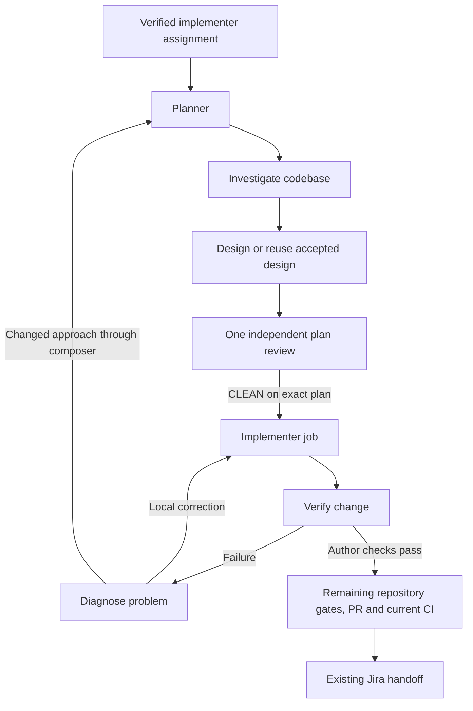

# Engineering skills

Pigboard's implementer now has six focused methods for learning the codebase,
designing a change, planning it, diagnosing problems and verifying the result.
They are original Pigboard instructions, informed by the research linked below.
The existing job and handoff skills still own execution and publication.

These methods are included in the prepared bundle. They have not yet demonstrated
an effectiveness improvement in comparative model trials. Installation does not
activate the mixed worker bundle; the existing release and live-acceptance gates
still apply.

## Which skill does what?

| Skill | Use | Result |
| --- | --- | --- |
| [engineering-principles](../skills/engineering-principles/SKILL.md) | Shared judgment for planning, execution and review | Decisions within the existing phase; no extra report |
| [investigate-codebase](../skills/investigate-codebase/SKILL.md) | Find actual flows, current patterns and suitable reusable code | Context with evidence and remaining unknowns |
| [design-change](../skills/design-change/SKILL.md) | Choose behavior, ownership, interfaces and relevant recovery | A design or an explained reuse of an accepted design |
| [planner](../skills/planner/SKILL.md) | Turn the verified assignment into one complete plan | A source-bound draft for independent review |
| [diagnose-problem](../skills/diagnose-problem/SKILL.md) | Explain a failure before the next fix | Supported cause, correction and recovery route |
| [verify-change](../skills/verify-change/SKILL.md) | Check actual behavior and provide reproducible evidence | Author PASS, FAIL or INCOMPLETE for the stated revision |

These are methods loaded by the assigned agent, not six new workers. Load the
shared principles once per phase and other methods when needed. Use the same
prepared bundle revision throughout a run. If a required sibling file is missing,
stop that dependent step and report the preparation problem; do not invent a
replacement or install it during delivery.

## How a change moves through them

The composer owns model-phase dispatch. A method cannot promote itself to another
model or approve its own plan. The job retains existing same-PR and repair rules.
The diagram omits wait/block exits, which remain in the shared
[handoff contract](../skills/implementer-entrypoint/references/handoff.md).

The plan keeps context, design, steps, verification, documentation/preparation,
sizing, open decisions and the author's seven-principle assessment in one
[record](../skills/planner/references/plan.md). Independent review binds its exact
hash and inputs. The new methods use existing handoff evidence references; they
do not add canonical status values or schema fields.

## Three ordinary decisions

**Reuse a suitable path.** A ticket adds an invoice export. The investigation finds
a shared tenant-scoped query and pagination iterator. The plan chooses that path
and checks other tenants and multiple pages. The implementer can choose ordinary
loop details without replanning. A similar admin helper that bypasses isolation
is unsuitable, even if it would need fewer lines.

**Correct a false assumption.** A reviewed plan assumes a payment API deduplicates
retries. The actual contract shows otherwise. The job preserves its work and
returns NEEDS_HIGH_PLAN before implementing a different approach. The composer
obtains a revised plan and fresh review, then resumes the same work. A genuine
assigned upstream repair uses DEPENDENCY_WAIT only with the required exact
references. An undefined refund policy is an owner decision, not permission to
choose product behavior.

**Check without ceremony.** A small formatting fix already has a useful output
test. The implementer makes the narrow change and runs final relevant checks; it
does not need a new test or a check after every edit. For a risky multi-step change,
intermediate checks may be valuable. In both cases the final evidence names the
checked revision, actual results and how another engineer can repeat them.

## Verification that accompanies the work

Use the project's existing tests and documentation. A useful recipe tells the
next person which build to check, what setup/data it needs, which commands or
journey to run, what success looks like and what temporary state to remove.
Retain useful automated checks with the change. Evidence must remain accessible
after cleanup, with secrets removed.

An empty green suite is not a pass. Nor is a passing mock proof that a real caller
works. Missing required access or an unavailable environment is reported as
INCOMPLETE through the job's existing blocker route. Changes after verification
require fresh affected checks or a justified unchanged result. Author checks,
independent review, CI and live acceptance remain separate claims.

## Careful changes to PR review

The [review core](../skills/pr-review/SKILL.md) keeps its 20 checks, eight reported
categories, evidence rules, verdict precedence and saved review-state design.
Only four criteria gain guidance: C06 checks a changed approach against its reviewed
plan; C07 checks actual execution and final-revision evidence; C13 checks whether
reuse is suitable; C19 checks whether the verification handoff is usable.

Shared engineering principles help the reviewer investigate. They do not override
project authority, create findings from preferences or add another report. A
compatibility test reconstructs the original review file by removing only these
declared additions, then verifies its original hash. The remaining review-state,
commenting and launch-prompt files retain their original hashes.

## Research influences and choices

The prose and integration are authored for Pigboard; no upstream skill, code or
runner is vendored. These sources informed the methods, not their execution rights:

- Pstack's [code exploration](https://github.com/cursor/plugins/blob/c742dd61706fbacc1b95f1a20b7b988cf096ce6c/pstack/skills/how/SKILL.md)
  and [architecture](https://github.com/cursor/plugins/blob/c742dd61706fbacc1b95f1a20b7b988cf096ce6c/pstack/skills/architect/SKILL.md):
  trace real code and choose coherent ownership. Pigboard retains reviewed plans
  rather than importing autonomous redesign or a default agent fleet.
- [Ponytail](https://github.com/DietrichGebert/ponytail/blob/96608e078b2d5ea607c5c3b8b5a54d1c1fba6846/skills/ponytail/SKILL.md):
  learn the codebase and prefer suitable existing mechanisms. Popularity is not
  comparative evidence; Ponytail remains a separate trial candidate.
- Superpowers' [plans](https://github.com/obra/superpowers/blob/22f0b463e7a5e579904dd6211a520321035526f7/skills/writing-plans/SKILL.md)
  and [debugging](https://github.com/obra/superpowers/blob/22f0b463e7a5e579904dd6211a520321035526f7/skills/systematic-debugging/SKILL.md):
  settle consequential decisions and test a causal explanation before patching.
- Addy Osmani's [source-driven development](https://github.com/addyosmani/agent-skills/blob/39b723ceebf81474d0557c1fecd01eddab585563/skills/source-driven-development/SKILL.md):
  resolve deciding facts from the supported version's sources without modernizing
  unrelated code or asking about every local choice.
- Compound Engineering's [implementation loop](https://github.com/EveryInc/compound-engineering-plugin/blob/ee46dde75a40e297bd8eac4055a410a771d3ac1d/skills/ce-work/references/implementation-loop.md)
  and gstack's [engineering review](https://github.com/garrytan/gstack/blob/81fb9008351d29fccc3e146d860a9cda8c104a2d/plan-eng-review/sections/review-sections.md):
  retain meaningful verification and review the fit of the solution as well as
  test results. Pigboard keeps its own review and publication architecture.

The owner sets the cadence: intermediate checks use judgment; final relevant
verification and a repeatable handoff are required. Copying upstream text or
helpers in a later change would require checking and retaining their notices;
this original implementation adds no upstream runtime dependency.
