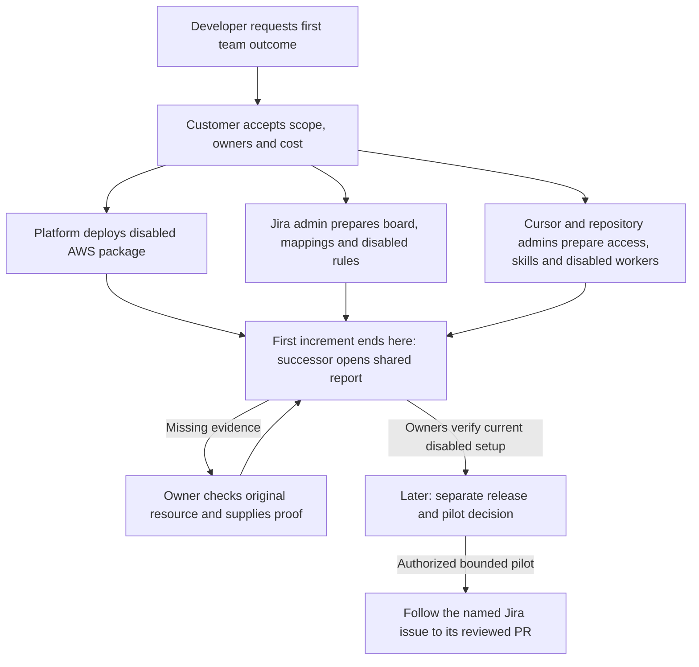

# A customer handoff for installing Pigboard

**Joint design decision for Daniel and the Pigboard director · 18 November 2026 · Provisional — not ready for delivery.**

**Decision requested.** Give the developer a request they can forward and give the next operator a private report that answers “Which controls were observed off, what is still unknown, and who acts next?” Start by reading existing receipts. Platform teams could publish the report from their usual infrastructure pipeline. Smaller teams could generate it locally and export it to the same kind of shared location. Choose the handoff to validate now. Defer the choice of which publishing route to build first.

## 1. Follow one request

> **Example request, invented.** “Please prepare Pigboard for the APP project and the payments repository. We want the first small bug fix to reach Human Review with its PR, independent review and QA evidence. Platform owns AWS costs and on-call, Jira Administration owns routing, Developer Tools owns Cursor and repository access, and the payments lead accepts the result. Please confirm those owners, the budget approver and who can enable and stop delivery. The private setup record will live alongside our platform change.”

The developer sends this through the customer's existing intake, such as a service ticket or a platform-repository PR. The recipient can accept, forward or return it with the missing owner or decision. The ticket points to the private change. Only the approved configuration in that change drives setup. A sponsor needs neither cloud credentials nor native Jira IDs.



**How a pilot would reach one PR.** Today, the customer and admins prepare the providers using their existing tools. The proposed report helps them see where preparation stands. Release acceptance and a separately authorized pilot come later.

1. The sponsor nominates one ready Story or Bug, such as APP-42 in the single numbered workstream AI-App-1. In an isolated, approved pilot scope, the operator verifies that the manager can see all work, it is the only manager allowed to start work there, and only APP-42 can become eligible throughout the authorized window. A manager invocation chooses eligible work itself. The Jira and Cursor owners also verify that every enabled trigger can start work only for APP-42, through the last review/QA handoff and shutdown. Use an isolated one-issue fixture or a verified issue-specific restriction. A workstream label alone allows another issue to trigger a worker. If either admission or downstream triggers cannot be confined for the whole window, keep the pilot off.
2. The AWS manager assigns eligible work in Jira and moves it to In Progress. A Jira rule sends an authenticated request to the matching Cursor automation. The worker uses the selected Build, a saved environment containing the pinned Pigboard skills. Three rule/automation pairs handle three stages. Implementation opens the Bitbucket PR. An independent reviewer checks the current PR, then QA runs the prescribed cases. Their Jira handoffs lead to Human Review.
3. The pilot operator closes admission after the authorized attempt and checks the manager has stopped, while already-authorized review and QA can finish. The sponsor follows APP-42 and its linked PR. On a stall, retain the issue, PR and original attempt, show the last verified stage and route the missing evidence to its owner. At the agreed pilot end the coordinator checks that the whole setup is stopped and records any outstanding work.
4. At Human Review the developer and human QA reviewer open the PR, see what changed and where, inspect current-head review and CI, and see QA results and human cases due. Receiving that usable packet is first team value. The customer retains acceptance and merge. [Admission contract](../manager-apply.md) · [Worker handoffs](../workflow.md)

**What we know.** The Safeguard INT record documents a reused status, a board whose actual filter differed from the prepared one, inactive routes and a manually initiated read-only probe. In the isolated 17 November exercise the manager started ordinary Jira work and its stop was verified. Operating health was UNKNOWN. Published source at `7d0552e` can report completion of an ordinary processing pass. That capability needs separate proof on the installed release. In the cold walkthrough, switching the sample to apply mode exposed incompatible timing settings. The command also hid a specific package mismatch behind a generic failure. The handoff should show both the exact installed revision and the available underlying diagnostic. [Safeguard setup](../jira-setup.md#safeguard-int-installation-observed-settings) · [Cold walkthrough](https://scubapig.atlassian.net/browse/PGB-91?focusedCommentId=11264) · [Readiness decision](https://scubapig.atlassian.net/browse/PGB-92?focusedCommentId=11262) · [Health guide](../manager-health.md)

**What we still need to learn.** The sponsor, intake queue, deployment runner, cost approver, incident and stop owners above are hypotheses at Safeguard. The director has no verified comparable rollout. With Daniel's authorization, ask participants to show the last similar request, who approved it, what evidence they accepted and who inherited it. Have the sponsor forward a dummy request unaided and a successor locate the missing Build. Give a second sponsor a request for another project and check whether they find the existing installation, recognize the unsupported change and leave the first project intact. Record hands-on time separately from waiting, returned requests, repeated entries and facilitator interventions. No participant interview or customer usability test has taken place. [Existing enterprise UX review](https://scubapig.atlassian.net/browse/PGB-95?focusedCommentId=11267)

## 2. What the customer keeps

Keep one reviewed file in the customer's private platform repository, or an access-controlled versioned location the local operator and successor can both reach. The first report reads existing configuration and receipts. The extended YAML and generated change plan below belong to a later provisioning increment. The excerpt below illustrates the proposed authoring experience. Today's closed v1 schema accepts the [complete current example](../../config/pigboss.example.yaml). The proposed fields need a versioned reader before use.

```yaml
# Proposed excerpt from platform/pigboard/company.yaml. All values are illustrative.
jira:
  site: https://work.example.invalid
  connection: {secret_reference: "arn:aws:secretsmanager:eu-west-1:123456789012:secret:pigboard-demo-AbCdEf"}
projects:
  - id: "10017"
    key: APP
    mappings:
      repositories: ["https://bitbucket.org/example/payments"]
      # The Jira admin confirms stages, issue types and actors in this same file.
manager:
  aws: {account_id: "123456789012", region: eu-west-1}
  controls: {mode: preview, schedule_enabled: false, writes_enabled: false, maintenance: false}
delivery:
  # One reviewed Pigboard source pin for package, skills and their generated settings.
  approved_revision: 7d0552e32e8bb606f4cab6be07b94087909d9a5d
  enabled: false
  cursor_team: example-dev-tools
  sender_secret_reference: example/jira-to-cursor
owners: {aws: platform-on-call, jira: jira-admins, cursor: dev-tools}
```

The example request links to the private platform change. Admins review the YAML there. The approved YAML describes desired settings. A generated plan shows what each owner would need to change. A receipt records what that owner actually did or saw. The private setup record indexes those receipts. The proposed read-only report is a dated view of that record. In the example the request has a single **Open setup report** link. The pipeline publishes to that customer location, or the local operator exports there and checks the successor can open it. Retain access for on-call handover under the customer's normal access policy.

The record names the sponsor, cost approver, pilot decision-maker, incident coordinator with stop authority, on-call contact or delegate for each provider, and who owns retention and removal. Each decision shows pending or approved, its scope and the customer's approval reference. Listed names and a report link confer no privileges.

A proposed plan resolves the project defaults once and shows each desired change, observed resource and owner. Read native Jira IDs and role mappings, review them once, and generate downstream settings and pinned worker instructions from them. The customer records the purpose and references. Each authorized provider owner or pipeline resolves credentials only within its own boundary. Keep secret values, webhook credentials, raw provider payloads and customer ticket content out of Git, build artifacts, logs and shareable reports. Protect any provider deployment state that can contain sensitive values. Scuba Pig receives no access.

**Outputs have different jobs.** The AWS package already produces the runtime zip, manifest and CloudFormation template. The customer pipeline can store the versioned zip, review the change set, deploy disabled and capture the stack ARN and asset version. The operator checks the actual stack against the package, saves that binding receipt, then initializes the new manager state once. Jira holds work and workflow truth. DynamoDB holds manager state and pending attempts. A private, durable installation record points to these original receipts and the provider owners' evidence. It survives CI artifact expiry and laptop turnover. Keep prior revisions. Never edit a generated binding to resolve a mismatch. [AWS package and role boundaries](../manager-installation.md) · [Existing configuration](../configuration.md)

For each system record the installation and resource IDs, approved revision and configuration digest, observed time, source and owner, owned versus adopted resources, original settings for a proposed reversal, outcome and next action. Mark evidence as a current authorized read, a dated owner observation, or missing. A saved observation can age or conflict with a newer one. A change of identity, revision or scope invalidates the affected check. Re-read affected facts before a write or enablement. With denied access or an ambiguous write, keep the original intent, evidence and a hold. Serialize changes per installation and reject a stale plan. A later run can recheck already confirmed steps without replaying them. [Current offline evidence comparison](../release-readiness.md)

## 3. What can be prepared

| Owner | Documented capability | Handoff and remaining proof |
|---|---|---|
| Platform | A reviewed customer pipeline can package the pinned release, preview a CloudFormation change set and deploy the versioned asset. Pigboard already binds and inspects the stack. | Customer prepares the bucket, secret, deployer and operator roles and approves IAM grants. Review replacements and costs. A template grants no organizational permission. [AWS change sets](https://docs.aws.amazon.com/AWSCloudFormation/latest/UserGuide/using-cfn-updating-stacks-changesets.html) |
| Jira admin | APIs support filters, board creation and reading the actual filter, subquery and column/status configuration. The rule API supports scoped creation disabled, redacted reads, update, enable/disable and deletion of disabled rules. | Verify actual sharing, native source-specific transitions, actors, and Story **and** Bug conditions for implementation, review and QA. Guide column mapping in Board settings. Reuse shared workflows without changing them implicitly. Scoped product authority is required. Forge/OAuth2 apps cannot call the rule-management endpoints. UI rule import/export needs global administration. Hidden request values are lost on copy/import. The Jira admin must use the sender credential from the Cursor owner in the rule’s hidden request header and may need the destination allowlisted. [Boards](https://developer.atlassian.com/cloud/jira/software/rest/api-group-board/) · [Columns](https://support.atlassian.com/jira-software-cloud/docs/configure-columns/) · [Rules](https://developer.atlassian.com/cloud/automation/rest/api-group-rule-management/) · [Permissions](https://developer.atlassian.com/cloud/automation/security/authorization/) · [Import](https://support.atlassian.com/cloud-automation/docs/import-and-export-jira-automation-rules/) · [Hidden values](https://support.atlassian.com/cloud-automation/docs/jira-automation-actions/#Hidden-values) |
| Cursor admin | Environment and Build APIs can create and inspect Builds and read the active selection. Cursor's Terraform provider declares a workflow's enabled flag, prompt, model, environment and webhook trigger. The ordinary automation REST update changes the model. | Build the approved external skills and verify the install receipt and selected Build. A previous Build can remain selected. Build creation by a team service account requires an agent-scoped key unrestricted by repository. A customer can keep that action with the admin. Inspect existing Builds after an uncertain response. The workflow schema provides no documented sender-key output. Exact credential handoff, model access and compatible tenant behavior still need proof. [Builds and selection](https://cursor.com/docs/cloud-agent/api/endpoints#start-an-environment-build) · [Workflow resource](https://github.com/cursor/terraform-provider-cursor/blob/v0.8.0/docs/resources/platform_workflow.md) · [Skill setup](../install.md#cursor-environment-setup) |
| Bitbucket and Cursor admins | Cursor documents personal Bitbucket Cloud OAuth and a workspace app connection in public beta. | The workspace admin installs the app and a Cursor team admin with workspace access links it. Verify actual worker identity, clone/push/PR access and the permitted repository. One workspace per Cursor team makes switching a shared connection consequential. Exact service-account access on this path is unverified. [Bitbucket integration](https://cursor.com/docs/integrations/bitbucket) |

Provider documentation establishes possible mechanics. The installed Pigboard pin, tenant grants, hidden sender credential and actual worker behavior require separate evidence. The AWS pipeline can produce inputs for delegated Jira and Cursor steps without holding either administrator's credentials.

## 4. What the successor sees

Excerpt from the proposed read-only report for APP’s single workstream, AI-App-1. An installation-wide view must cover every configured project and each full workstream label in scope. Check all three roles per stream even where a native rule is shared. An omitted project, stream or role leaves coverage unverified. Each evidence link opens only for an authorized customer user. The same rows are available as structured fields for a pipeline or agent.

```text
APP / AI-App-1 / payments · Desired: disabled · Observed: partial · Open setup report
AWS     10:20  saved operator read   Original stack matched. Schedule and writes off. [receipt]
Jira    10:23  saved admin read      Three scoped rules off. [rule checks]
Cursor  10:24  saved admin read      Three automations off. Active Build unverified. [environment]
Workers        no observation        Current or prior runs unknown.
Next    Developer Tools on-call     Inspect the selected Build and the install receipt for this pin.
Then    Platform on-call            Refresh affected rows. Keep the original AWS and Jira evidence.
Pilot   Approval pending. Owner: Payments lead. Stop coordinator: Platform on-call. [decision]
```

Here *partial* is a useful handoff. The dated rows tell the successor which completed work to preserve. Build selection and worker activity remain unknown, and current verification is still due before activation. The proposed machine-readable row carries the same conclusion, for example `{"component":"cursor.build","state":"unverified","source":"missing","owner":"dev-tools-on-call","next":"inspect_active_build","expected_revision":"7d0552e32e8bb606f4cab6be07b94087909d9a5d"}`. If a later read shows a matching Build exists but is unselected, the owner verifies it before selecting it. A default image, an older Build and an inaccessible environment each remain distinct findings.

| Walkthrough | What the operator does and learns |
|---|---|
| Fresh, disabled | Approve the request, preview the component changes and prepare each in its own account. Verify bound AWS package, disabled schedule/writes, three inactive Jira routes, three inactive Cursor automations, selected Build and matched receipts. Report *compatible supplied evidence* where only saved observations exist. Before pilot activation, require release and worker acceptance, full visibility, sole admission ownership, reviewed inventory and explicit owner authorization. Verify each newly authorized control change before permitting admission. |
| AWS succeeded, Build unconfirmed | The successor opens the report linked from the request and forwards the Cursor row to Developer Tools. That owner checks for the matching Build first. If preparation is actually missing, the authorized owner can build, verify the receipt and select the result. If AWS binding is also missing, platform inspects the original stack. Redeploying AWS cannot establish either missing fact. Delivery stays off. |
| Health, stop and resume | Read manager health, unresolved attempts, route state and worker activity separately. A completed scan can leave work held. A denied read leaves health unknown. For an emergency stop, the named incident coordinator requests all three shutdowns immediately. The AWS operator blocks new admission, disables scheduling and verifies concurrency zero after the bounded wait. Jira and Cursor owners independently disable and re-read their routes, even if another provider is unavailable. Record in-flight requests and active or unobserved workers separately. Report *manager stopped / whole stop partial* until every required control and outstanding activity is accounted for. |
| An enable overlaps a stop | A stop decision invalidates queued enables and bars new ones. An earlier enable can still reach AWS, Jira or Cursor after an initial “off” read. Today the AWS configure command can restore host controls before its final state check. For a coordinated whole stop, keep it *partial* while any earlier change could still take effect. Each provider owner accounts for already-dispatched writes, waits for a known terminal outcome, disables again if needed, then re-reads the affected controls. The coordinator confirms stop only from those later reads and the disposition of outstanding work. If an owner cannot establish that an earlier change has settled, keep the stop request active, escalate to the incident owner and show exactly which layer remains uncertain. |
| Resume after stop | A stale configuration or a green health check cannot authorize a restart. The coordinator verifies the original installation, controls and held work. Outstanding effects must be safely contained before the named pilot owner authorizes a new change. Otherwise keep the affected scope stopped. Provider owners verify their routes, then the AWS operator and deployer restore admission last. Unresolved effects stay held without replay. |
| Second project | The sponsor submits a change to the same file. Compare immutable site/project IDs, project-specific mappings, repo, access, costs and overlapping/shared resources. Preview the new scope while showing the first project's current state. Today's controller rejects adding a project after install. A future supported migration would preserve the original state and holds, verify both projects and their access with delivery fenced, and require an explicit enable decision. Until proven, return *unsupported change* and leave the first project as observed. [Company scope](../configuration.md#preview-changes-and-recover-safely) |
| Update or remove | For supported same-source settings, preview the diff and current resource ownership, fence, drain, verify and retain old and new receipts. For a new release, preview compatibility across manager, state, skills, Builds and routes. General source upgrade/rollback is unsupported today. Keep the original tools and selection usable for recovery. For removal, stop every layer, inspect original attempts and active workers, then show each owned resource slated for deletion, each adopted/shared resource to preserve, and retained State, logs, assets and costs. Owners approve their part, revoke dedicated credentials and verify disposition. Reverse a dedicated change only if its identity and current value still match. Preserve shared filters, connections and unrelated edits. Unknown ownership or unresolved effects holds the affected removal. [Lifecycle and recovery](../manager-installation.md#remove-and-recover) |

**Offline trial.** We ran 12 invented cases through a decision table. A missing AWS binding returned *unverified*. The original stop card used “stop confirmed” for a manager-only result. We corrected the scope in a follow-up table. With the manager stopped, a missing Cursor read or an uncertain attempt kept whole-installation stop partial and named the next owner. A queued enable based on a pre-stop decision stayed superseded. A clean mock resume still required owner authority. Both a later project addition and a source revision change returned *unsupported*. Removal with an outstanding attempt stayed held. In a separate file handoff, the successor lookup returned “Cursor administrator” from a shared pipeline artifact and from a byte-identical private local export. With the handoff directory empty it returned “no handoff.” These checks test the example decisions and file transfer. They establish no tenant access, usability timing, or actual first PR.

## 5. What to decide

**Choose the shared record first.** A platform-repository change gives review history, existing deployment approvals and a natural place to hand over evidence. It adds queue time where teams lack such a pipeline. A guided local run can fit a small team, but its receipts must reach a durable customer location before handoff. Both can use one config, the existing validators and the same status format. A single cross-account wizard would require a concentration of permissions our evidence does not justify. No new user interface needs to be selected yet. [Original operator proposal](https://scubapig.atlassian.net/browse/PGB-95?focusedCommentId=11263)

**Validate before building.** If Daniel authorizes participant discovery, the installation discovery lead facilitates a mock request and report using invented or approved, redacted receipts. The trial needs no new software or provider permissions. Test whether the recipient accepts the request or names a missing decision, and whether the successor can open the evidence, route the missing Build and preserve completed work. Favor pipeline publication when the real platform recipient can publish a durable, accessible report through existing approvals. Favor local export when the responsible operator can hand over equivalent evidence more directly. Compare waiting, hands-on time and interventions. If both or neither fit, record the result and bring the choice to the owners.

**Provisional sequence.** After participant feedback and a reviewed delivery plan, the smallest useful product increment would produce that read-only handoff from existing configuration and receipts. The request succeeds when its recipient can identify the scope and approvers or return it with a named missing item. The report succeeds when the successor identifies the missing Build, its owner and next action while preserving completed work. Before adding provider writes, prove the delegated operations on explicitly authorized isolated fixtures. Then consider generating disabled changes for each provider, followed by controlled day-two updates, scope expansion and removal. The separately approved one-issue pilot above would measure the path through Human Review once PGB-91, PGB-92 and PGB-58 supply the necessary acceptance and authority. Epic 66 keeps the manager, installed acceptance and readiness decision. PGB-58 owns live worker acceptance. PGB-183 owns the cross-system customer journey. Delivery Stories, estimates and activation await their own decisions.

1. **For Daniel and the director.** Should we validate the request and shared report first, leaving pipeline versus local delivery open, or prioritize another handoff? This decision selects product direction. Implementation would require a subsequent reviewed delivery plan.
2. **For Daniel.** Is there a redacted comparable rollout or an authorized participant for an uncoached handoff before we choose which route to build first? Without one, carry both routes and the unverified roles forward.

[Installation UX epic](https://scubapig.atlassian.net/browse/PGB-183) · [Discovery and review record](https://scubapig.atlassian.net/browse/PGB-95) · [Manager acceptance](https://scubapig.atlassian.net/browse/PGB-91) · [Worker acceptance](https://scubapig.atlassian.net/browse/PGB-58)
